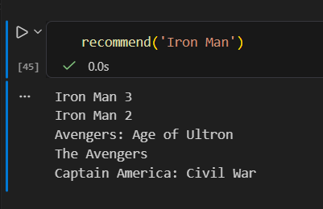
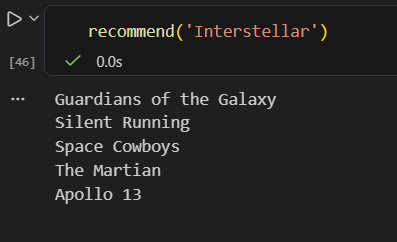

# Movie Recommendation System

A content-based movie recommendation system built using Python, Pandas, and Scikit-learn. The project uses movie metadata and credits to explore similarities between movies and generate recommendations.

# Results




## Dataset

This project uses the TMDB 5000 Movie Dataset.

- `tmdb_5000_movies.csv`
- `tmdb_5000_credits.csv`

## Technologies Used

- Python
- Pandas
- NumPy
- Scikit-learn
- Jupyter Notebook

## Project Structure

```text
movies_recommender/
├── .gitignore
├── movies_recommender.ipynb
├── tmdb_5000_credits.csv
└── tmdb_5000_movies.csv
```

## Getting Started

### 1. Clone the repository

```bash
git clone https://github.com/Suryanshuv14/movies_recommender.git
cd movies_recommender
```

### 2. Create a virtual environment

```bash
python -m venv myenv
```

Activate it on Windows:

```powershell
.\myenv\Scripts\Activate.ps1
```

### 3. Install dependencies

```bash
pip install pandas numpy scikit-learn jupyter
```

### 4. Run the notebook

```bash
jupyter notebook movies_recommender.ipynb
```

Open the notebook and run the cells in order.

## Dataset Source

[TMDB 5000 Movie Dataset on Kaggle](https://www.kaggle.com/datasets/tmdb/tmdb-movie-metadata)

## License

This project is intended for educational purposes.
